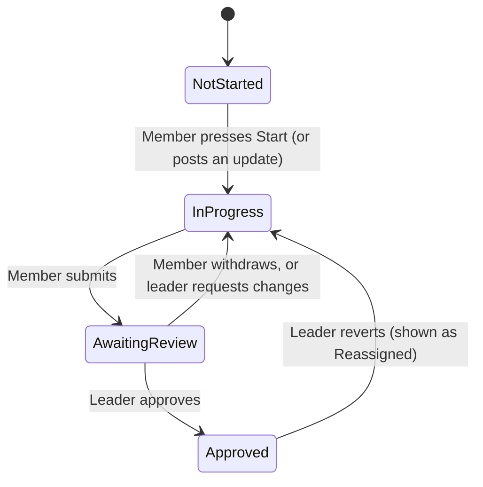

# ProjectTrack

**A team project tracker for college groups.** Plan every subject's deliverables, assign work and tasks, follow progress while it happens, review submissions, and keep a record of who did what and when. Built for the way a student team actually works: one group leader, a few members, several subjects, one semester at a time.

[](../../actions/workflows/ci.yml)

---

## Contents

- [Features](#features)
- [How work flows](#how-work-flows)
- [Tech stack](#tech-stack)
- [Quick start](#quick-start)
- [Deploying to Vercel](#deploying-to-vercel)
- [Upgrading an existing database](#upgrading-an-existing-database)
- [Roles and permissions](#roles-and-permissions)
- [Rules the database enforces](#rules-the-database-enforces)
- [Project structure](#project-structure)
- [Data model](#data-model)
- [Configuration](#configuration)
- [Installable app (PWA)](#installable-app-pwa)
- [Quality and security](#quality-and-security)
- [Troubleshooting](#troubleshooting)
- [Roadmap](#roadmap)

---

## Features

**For every group**
- **Groups for anyone.** Create a group (you become its leader) or join one with an 8-character code. Each group's data is private to its members.
- **Semesters.** One current semester per group. Starting a new semester archives the old one as read-only history (still viewable from the switcher) and optionally copies the subject list forward.
- **Live everywhere.** Changes appear for everyone instantly, on phone and laptop.
- **Installable.** Works as an app on Android, iOS and desktop (PWA).

**For members**
- **My work.** Everything assigned to you, sorted by what needs you first: changes requested, overdue, in progress, waiting for review.
- **Start working.** One tap records when you began, visible to the leader in the history.
- **Progress updates.** Pick one of your assigned projects and post how it is going (on track, almost done, need help, blocked), a rough percentage, what you have done, and optionally a GitHub link, another link and files.
- **Submit for review.** App and Website deliverables take a deployed link and/or GitHub repository. PPT, Report, Research Paper and Logisim deliverables take a file upload. Custom ones take either.
- **Tasks.** Small action items from the leader. Submit them for review the same way.
- **Notifications.** A bell shows new assignments, approvals, requested changes and deadline changes, and clears each one once you have seen it.
- **Deadline protection.** Past a deadline you cannot upload or submit. You see "the deadline is over, ask your leader for more time" and can send an extension request in one tap.

**For the group leader**
- **Plan.** Choose what each subject requires, set weights, assign owners, set deadlines and project leads.
- **Weight rebalancing.** Change one weight and choose which others give up (or receive) the difference; it is shared evenly so the total stays 100%.
- **Tasks per project.** Assign tasks before work starts or later when something needs changing.
- **Approvals.** A queue of submitted deliverables and tasks. Approve, request changes with a reason, or revert an approval (the work returns to the member as reassigned). Every approve, revert and sign-out asks "are you sure" first.
- **Extend deadlines.** One-tap +1 day, +3 days, +1 week, or pick a date. The member is notified.
- **Scoreboard and analytics.** Overall progress ring, per-subject lanes with a "should be here by now" marker, team table, burn-up chart, workload and contribution charts, deadline horizon.
- **Team management.** Approve people who join, change roles, deactivate members, rotate the join code.
- **Exports.** Copy a status report or download a CSV.
- **Import.** Bring over data from the original browser-only version (Backup JSON).

## How work flows

Deliverables and tasks go through the same review. Nothing counts until the leader has seen it.



- The confirmed percentage only counts **approved deliverables**, weighted within their subject. Tasks never change it.
- **Past the deadline**, the assigned member is locked out until the leader extends the date.
- **Approved** work is locked for the member until the leader reverts the approval.

## Tech stack

| Layer | Choice |
|---|---|
| App | Next.js 14 (pages router), React 18, TypeScript |
| Styling | Tailwind CSS, self-hosted fonts (Barlow Condensed, IBM Plex Sans) |
| Charts | Recharts |
| Backend | Supabase: Postgres, Auth, Storage, Realtime |
| Hosting | Vercel |
| Offline shell | Service worker (app shell only, data is always live) |

There is no custom server. The browser talks to Supabase directly, and **Postgres row level security and triggers enforce every permission**, so the rules hold even if someone bypasses the interface.

## Quick start

You need Node 18+ and a free [Supabase](https://supabase.com) project.

### 1. Create the database

In Supabase, open **SQL Editor, New query**, then paste and run these files **in order** (each once). Use the first path for a new project:

| Step | File | Notes |
|---|---|---|
| 1 | `supabase/migrations/001_init.sql` | Groups, semesters, subjects, deliverables, files, activity, security rules |
| 2 | `supabase/migrations/003_tasks.sql` | Tasks with the review workflow |
| 3 | `supabase/migrations/004_notifications_weights.sql` | Notifications and weight rebalancing |
| 4 | `supabase/migrations/005_progress_deadlines.sql` | Deadline locking, Start log, progress updates, extension requests |

Files 003 to 005 are safe to run again. `002_upgrade_from_v1.sql` is only for [upgrading](#upgrading-an-existing-database).

### 2. Configure the app

```bash
cp .env.example .env.local
```

Fill in two values from **Project Settings, API Keys** in Supabase:

```
NEXT_PUBLIC_SUPABASE_URL=https://YOUR-PROJECT-REF.supabase.co
NEXT_PUBLIC_SUPABASE_ANON_KEY=YOUR-PUBLISHABLE-KEY
```

The publishable key is designed to be public. **Never** put a `service_role` key in these variables.

### 3. Authentication settings (Supabase dashboard)

- **Authentication, URL Configuration:** set **Site URL** to your deployed address and add it (and `http://localhost:3000`) under **Redirect URLs**.
- **Authentication, Providers, Email:** you may switch **Confirm email** off for instant sign-up in a small trusted group. Leave it on for public use.

### 4. Run it

```bash
npm install
npm run dev
```

Open http://localhost:3000, create an account, choose **Create a group**, and share the join code from the **Team** page. People who join wait for your approval.

## Deploying to Vercel

1. Import the repository into Vercel.
2. Add `NEXT_PUBLIC_SUPABASE_URL` and `NEXT_PUBLIC_SUPABASE_ANON_KEY` under **Settings, Environment Variables** (Production, Preview, Development).
3. Deploy. Every push to `main` redeploys.
4. Add the Vercel address to Supabase **Redirect URLs** (step 3 above) so confirmation and password-reset emails return to the right place.

## Upgrading an existing database

**Already ran an earlier version of this app on your Supabase project?** Do not run `001_init.sql` (it would fail with "relation already exists"). Instead:

1. If you only have the first version (profiles with roles, no groups): run `002_upgrade_from_v1.sql`. It keeps every row, puts everything into one group ("My group") and one semester ("Semester 1"), and moves old proof links to the right field for each deliverable type. It runs as one transaction, so a failure changes nothing. Rename the group and semester afterwards in the app.
2. Then run `003_tasks.sql`, `004_notifications_weights.sql` and `005_progress_deadlines.sql` in order.
3. If you are already on groups and semesters, run only whichever of 003 to 005 you have not run yet.

**Coming from the original browser-only version?** In the old app press **Backup JSON**. In the new one, as group leader, open **Plan** and use *Bring over data from the original ProjectTrack*. People are matched by name, so have teammates join first.

## Roles and permissions

| | Member | Group leader |
|---|---|---|
| See the group's subjects, deliverables, tasks, updates and activity | Yes | Yes |
| Start, update, upload and submit their own assigned work | Yes, until the deadline | Yes |
| Post progress updates on their own work | Yes, until the deadline | Yes |
| Create, assign, edit and delete subjects, deliverables and tasks | No | Yes |
| Approve, request changes, revert an approval | No | Yes |
| Extend deadlines, rebalance weights | No | Yes |
| Approve people who join, change roles, rotate the join code | No | Yes |
| Rename the semester, start a new semester | No | Yes |
| Anything in an archived semester | Read only | Read only |

A person can belong to several groups with a different role in each.

## Rules the database enforces

These are checked in Postgres, not just hidden in the interface:

- A group sees only its own data. Other groups and signed-in strangers see nothing.
- Members can only change their own assigned work, and only before the deadline.
- Nothing is approved unless it was submitted for review first.
- Approved work is locked until the leader reverts it.
- Past a deadline, members cannot edit, upload, remove files, post updates or submit.
- App/Website submissions need a link or GitHub repo; PPT/Report/Research Paper/Logisim need an uploaded file.
- Links must start with `http://` or `https://`.
- Archived semesters cannot be changed.
- A group always keeps at least one active leader.
- Notifications are private, and only the read flag can be changed.
- Every submit, approval, revert, assignment, start and update is written to the activity log automatically.

## Project structure

```
components/
  views/            Scoreboard, Board, My work, Approvals, Analytics, Plan, Team, Activity
  Shell.tsx         Layout, navigation, mobile tab bar
  TaskDrawer.tsx    Deliverable detail: start, submit, review, updates, tasks
  TaskList.tsx      Tasks with the review workflow
  ProgressUpdates.tsx   Post and read progress updates
  NotificationBell.tsx  Live notifications
  WeightDialog.tsx  Rebalance weights
  WorkspaceMenu.tsx Group and semester switcher
  motion.tsx        Scroll reveal, count-up, tilt, parallax
  charts.tsx        Recharts charts
lib/
  store.tsx         Auth, data loading, realtime, every mutation
  calc.ts           Progress, deadlines, burn-up, weight maths
  legacy.ts         Importer for the original app's backup
  types.ts          Shared types
pages/              Next.js entry (client-rendered)
public/             Icons, manifest, service worker, offline page
supabase/migrations/  The database, in order
.github/workflows/  CI (type check and build)
```

## Data model

`profiles` → `memberships` ← `groups` → `semesters` → `subjects` → `deliverables`  
`deliverables` have `attachments`, `progress_updates` and `tasks`  
`activity` and `notifications` record what happened and tell people.

Every table carries `group_id` (and `semester_id` where relevant), set by the database from the parent row, never trusted from the browser.

## Configuration

| What | Where | Default |
|---|---|---|
| Time zone used for "is it past the deadline" | `private.today_local()` in `005_progress_deadlines.sql` | `Asia/Kolkata` |
| Maximum file size | Storage bucket limit in `001_init.sql` and `MAX_FILE` in `lib/store.tsx` | 25 MB |
| Join code | Team page, "New code" | 8 characters, rotatable |
| Default theme | `pages/_document.tsx` | Light (Auto and Dark available) |

Supabase's free plan has its own 50 MB per-file ceiling.

## Installable app (PWA)

Works over HTTPS (your Vercel address). Android, Chrome and Edge show an **Install app** button; on iPhone use Safari, Share, Add to Home Screen. Only the app shell is cached. Team data always loads live, so offline you see a friendly offline page instead of stale information. Pinch-zoom is disabled to feel like a native app.

Alerts while the app is open in the background are supported (opt in from the bell). Alerts when the app is fully closed would need push notifications or email, which are not included yet.

## Quality and security

- **CI** (`.github/workflows/ci.yml`) type-checks and builds on every push and pull request.
- **Error boundary** shows a recovery screen instead of a blank page if something unexpected breaks.
- **Security headers** (`nosniff`, frame denial, referrer policy, permissions policy, HSTS) are set in `next.config.mjs`.
- **Row level security** is on for every table; helper functions live in a private schema that the API does not expose.
- **Private storage:** files sit in a private bucket and open through short-lived signed links.
- Secrets: only the public anon key is used in the browser. Keep any service key out of the repository.

Run locally:

```bash
npm run typecheck
npm run build
```

## Troubleshooting

| Symptom | Cause and fix |
|---|---|
| "Connect your database" screen | `NEXT_PUBLIC_SUPABASE_URL` / `NEXT_PUBLIC_SUPABASE_ANON_KEY` are missing. Set them and redeploy (they are baked in at build time). |
| "Failed to fetch" on sign-in | The Supabase project URL is wrong, or the project is paused. Check the URL and resume the project. |
| `relation "profiles" already exists` | The database already has tables. Use [the upgrade path](#upgrading-an-existing-database), not `001_init.sql`. |
| Sign-up emails link to the wrong address | Set Site URL and Redirect URLs in Supabase Authentication, URL Configuration. |
| A member says "the deadline is over" | Expected. Extend the date (drawer or task, "Extend") and they are notified and unlocked. |
| New people cannot see anything | They are waiting for approval. Approve them on the **Team** page. |
| Looks stale after a deploy | Hard refresh once (Ctrl+Shift+R), or close and reopen the installed app. |

## Roadmap

- Email and push notifications when the app is closed
- Deadline reminders (for example one day before)
- Comments on deliverables
- Calendar export (.ics)
- Co-leaders and per-subject leads with their own approval rights
- Error reporting (Sentry) and uptime monitoring
- Automated end-to-end tests in CI
